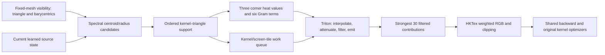

# HKTex and Hybrid HKS: current implementation

Source review: November 18, 2026. This guide describes supported code after the
[pipeline-only cleanup](HKS_PIPELINE_ONLY_CLEANUP.md). Prior cleanup/rename reports
remain historical records. No GPU correctness or performance is implied by source
inspection or CPU-interpreter results.

The [shared-module rename guide](HKS_SHARED_MODULE_RENAME.md) maps the former
triangle-splat filenames to the current layout, contribution and reconstruction
modules. The renderer and its shared mathematical operations are unchanged.

## Two primary implementations

Original pointwise HKTex remains unchanged in `hktex/`. The matched recipe uses
pointwise outer-50 neighbors and strongest-30 filtered contributions. Those are
recipe settings, not a change to the original classes' own defaults.

Hybrid HKS selects kernels for visible destination triangles, evaluates their
spectral heat at three corners, and reuses those values at visible pixels.
The mesh and spectral archive remain fixed. Source locations, anisotropy,
orientation, colors and filter parameters retain original optimization behavior.
Configured diffusion time stays fixed; explicit time overrides remain differentiable.

Both methods retain spectral heat and HKTex weighted color reconstruction.
Destination visibility determines writes; a source need not itself be visible.
Hybrid is triangle-supported surface rendering, not a collection of Gaussian disks
or ellipsoids and not depth-ordered alpha compositing.

## Actual call flow

Tile scheduling precedes pixel arithmetic. Barycentric interpolation and contribution
weighting execute inside the emitter; cleanup did not add or substitute a rendering pass.

| Stage | File | Functions/classes and data |
| --- | --- | --- |
| Command / original initialization | `splatting_script/experiments/compare_backends.py`, `benchmarks/renderer_comparison.py` | `main` → `_execute`; original loader constructs the mesh, model, eigensystem and optimizers. |
| Visible mesh samples | `hktex_splatting/rendering/mesh_visibility_raster.py`, `fast_raster.py` | `BVHRaster.all_buffers` → `_fast_kernel`; fixed depth winner, face IDs and barycentrics. |
| Immutable pixel/tile layout | `rendering/heat_kernel_splatting.py`, `triangle_tile_layout.py`, `prepared_geometry.py`, `gpu_dispatch.py` | `TileSurface`, `dispatch`, `PreparedGeometry`, `DeviceDispatchGeometry`; visible face/tile patches and guarded device snapshots. |
| Source spectral state | `modules/spectral_heat_field.py` | `LiveHeatField.sources`; interpolate source mesh coordinates and four neighboring anisotropy/orientation grids, spectral decay and source self-normalization. |
| Candidate bounds and ranking | `knn_heat/packed_support.py`, `triangle_kernel_support.py`, `triton/resident_gpu.py` | `PreparedSupport.__init__`, `FusedResidentSupportGeometry.candidate_rows`; fixed triangle centroids/radii, fresh source distances, small-row selection or bounded tile merging, ascending retained IDs. |
| Support construction / fallback | `knn_heat/triangle_kernel_support.py`, `triton/resident_gpu.py` | `ResidentSupportGeometry.select`, `FusedResidentSupportGeometry.select`; pack ordered face CSR and allocation counts. |
| Corner heat / Gram coefficients | `modules/spectral_heat_field.py`, `spectral_heat_coefficients.py`, `triton/spectral_heat_coefficients.py` | `LiveHeatField.coefficients` → `fused_coefficients` → `coefficients_forward`; fresh three-corner heat and six symmetric distance terms per supported pair. |
| Current coefficient topology | `rendering/resident.py` | `ResidentTopology`; gather supported face vertices and source IDs, checking mesh/archive/support versions. |
| Triangle/tile scheduling | `rendering/heat_kernel_splatting.py`, `triton/heat_kernel_splatting.py` | `triangle_tile_work` → `group_triangle_work`; expand visible face patches, stable-sort integer kernel/tile keys, keep ordered triangle-entry ranges and pixel offsets. |
| Pixel splatting | `triton/heat_kernel_splatting.py` | `_hybrid_emit`; match visible face inside a kernel/tile group, interpolate prepared values, filter and write scalar weight/entry records. |
| Strongest contributions | `triton/splat_contributions.py` | `merge`; rank nonnegative filtered weights with deterministic entry-order ties. Controlled inner count is 30; existing reduction guards are preserved. |
| Final RGB | `triton/splat_reconstruction.py` | `reconstruct`; fetch learned colors, weighted sum, denominator floor, mean color and clipping. |
| Contribution backward | `rendering/splat_autograd.py`, `triton/splat_reconstruction.py`, `heat_kernel_backward.py` | `_HybridSplat` inherits `_Splat.backward`; selected-record/color/filter adjoints with fixed support and visibility. |
| Spectral backward | `modules/spectral_heat_coefficients.py`, `triton/spectral_heat_coefficients.py` | `_Coefficients.backward` → `coefficients_backward`; source spectral/grid/normalizer/embedding adjoints. |
| On-mesh optimization | Original `hktex/modules/geodesic_opt.py` and trainer calls | Original optimizer/tracer updates positions and face IDs; other parameter optimizers, schedulers and post-step clamps are unchanged. |
| Benchmark / profiler | `splatting_script/benchmarks/renderer_comparison.py`, `pipeline_profile.py`, `pipeline_workflow.py` | Matched timing/memory/PSNR, embedded correctness gates and separate diagnostic profiles. |

Within a row, paths lacking a package prefix are relative to `hktex_splatting/`,
except `benchmarks/` paths, which belong to `splatting_script/`.

## Spectral support and heat

A triangle has a centroid `c` and radius `r` in the fixed original isotropic
spectral embedding. Candidate selection uses current source embeddings and the
existing guarded distance condition based on `d_k(c) + 2r`. The optional pool cap
is an approximation applied per destination triangle. It does not cap triangles
per source and does not constrain sources to camera visibility.

The existing row selector remains in use through 4,096 sources. Wider tables use
`merge_support_tile` and `finish_support_tiles` in `triton/resident_gpu.py`:
source tiles contain at most 1,024 entries, and a rolling list retains enough
candidates for the neighbor rank and triangle cap. All sources are examined;
the support bound and ascending-ID CSR contract remain. Distance ties on this
wide path use source-ID order, which may differ from the old PyTorch fallback.
Count/scan/CSR dispatch no longer falls back solely because of source count.
Pinned-Torch, dtype/shape, index and allocation guards still apply. See
[the tiled selector](TILED_SELECTOR.md) for exact scope and validation limits.

No eigensystem is recomputed during rendering or training. In schematic notation,
using the configured grid mixtures for the eigenvalues/eigenfunctions:

$$
h_{ki}=\frac{\sum_\ell e^{-\lambda_{k\ell}t}\phi_{k\ell}(s_k)\phi_{k\ell}(v_i)}
{\sum_\ell e^{-\lambda_{k\ell}t}\phi_{k\ell}(s_k)^2+\epsilon_h}.
$$

Each supported pair stores three such heat values and six symmetric Gram terms
for source-relative squared embedding distance. At pixel barycentrics `b`, the
emitter evaluates `h = sum_i b_i h_ki` and `d = max(b^T G b, 0)`, then applies the
preserved intrinsic distance attenuation and learned soft filter. This is a
scalar spectral influence, not an RGB primitive projected into the image.

## Tiles, pixels and RGB

Fixed visibility supplies the screen-space support: a source can affect visible
samples of its selected destination triangles. Supported triangle patches expand
to kernel/tile tasks, then share one queue item for each unique kernel/tile key.
The emitter locates each pixel's face within that key's ordered triangle range.
It fills pixel-segmented records directly, then ranks filtered weights.

For the retained strongest contributions `S_p`, reconstruction is

$$
C_p=\operatorname{clip}\left(\bar C+
\frac{\sum_{k\in S_p}w_{pk}c_k}{\max(\sum_{k\in S_p}w_{pk},1)},0,1\right).
$$

Background is zero. The original learned mean, residual colors, attenuation,
filtering, tie rules and clipping/subgradients remain. There is no depth-sorted
alpha-compositing stage. Discrete support, visibility and top-k membership are
held fixed for backward; source/grid/coefficient computations remain differentiable.
Higher derivatives and mesh/camera/visibility gradients retain their existing limits.

## Why reference-named modules remain

- `resident.py` provides `ResidentDispatchGeometry` and `ResidentTopology` used
  by every hybrid forward. Its baseline `build_scene` control is used by benchmark
  RGB/support/VJP/optimizer comparisons; it is not a selectable training backend.
- `splat_autograd.py` retains the generic baseline forward for that independent
  control and the backward inherited by hybrid. Safety and capacity checks remain.
- `triangle_tile_layout.py` retains only fixed-layout planning and its payload;
  unused standalone CPU RGB reconstruction was removed.
- `triangle_heat_map.py` retains the `FaceMap` payload required for empty fixed
  geometry initialization; duplicate candidate/shading implementations were removed.
- `full_spectrum_work`, `_torch_splat_responses` and `_splat` form the bounded
  full-spectrum eager oracle used to report candidate omissions and spectral
  response agreement. It is a diagnostic dependency, not the removed standalone
  direct-spectral GPU renderer.

These controls preserve existing validation tolerances and independence. Removing
them would weaken reproducibility checks. Main training always uses native or hybrid.

## Intentional removals and compatibility

Projected conic/footprint pruning and positive `footprint_cutoff` support are gone.
No source footprint is projected. The triangle centroid/radius support criterion,
visible face/tile layout and GPU tile scheduling remain required. New reports may
retain a fixed zero `footprint_cutoff` metadata field so historical readers preserve
matching rules; there is no adjustable cutoff option or pruning code behind it.

Standalone resident/splat modes, the old forward trainer, tile-KNN/direct-native
selection controls and renamed-module aliases were retired. Primary `native`,
`hybrid`, `original` and `2dgs` commands remain. Canonical imports and original
HKTex model/optimizer state dictionaries are supported. Old experimental commands
and whole-object HKS pickles naming retired modules require their original archived
source environment. No checkpoint or scientific result was rewritten.

See [the cleanup report](HKS_PIPELINE_ONLY_CLEANUP.md) for every file/function
removed, the dependency gate, source recovery and actual test results. GPU correctness
still requires an allocated device; CPU interpreter parity does not establish CUDA
atomics, FAISS stream behavior or real geodesic-tracing parity. Saved preliminary
measurements retain their original workload/source identities; no new performance
or convergence improvement is claimed.
