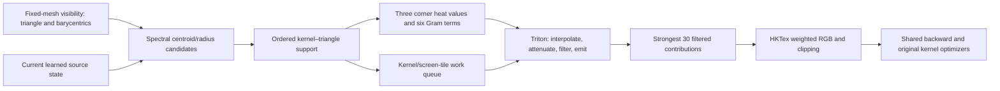

# Kernel-centric HKS: current architecture

Updated 2026-11-23. The default renderer is kernel-centric, triangle-supported
Heat-Kernel Splatting. The historical guide below describes the previous
triangle-to-kernel search and is retained to interpret older results.

1. Fixed mesh, spectral archive and edge adjacency are loaded/prepared once.
   `KernelSurfaceSupport` in `hktex_splatting/knn_heat/triangle_kernel_support.py`
   prepares a bounded fixed-hop neighborhood lookup (provisional default: eight).
2. `LiveHeatField.sources` refreshes learned source locations, spectral mixtures,
   decay, normalization and embedding each forward. Mesh/eigensystem stay fixed.
3. Each kernel looks up neighbors of its **current source face**.
   `count_kernel_surface_support` / `pack_kernel_surface_support` in
   `triton/resident_gpu.py` count current visible pairs and pack sorted face-major
   CSR with one bounded allocation readback. The eager path independently retains
   the original tensor selector. Full source-major faces are materialized only
   when explicitly inspected. No heat, colors or visibility images
   are cached. Geometry lookup changes neither the defined hop set nor gradients.
4. Existing spectral coefficient operators evaluate three heat corners and six
   Gram terms per pair. Barycentric interpolation and intrinsic Gaussian distance
   attenuation produce per-pixel heat responses.
5. Existing triangle/tile queues feed Triton contribution emission. The rescaled
   sigmoid filter uses CUDA library exp and rounded division to match Torch at
   saturated float32 top-30 boundaries. This fixes demonstrated one-ULP selection
   errors without changing the filter equation or quantizing weights.
6. Top 30 uses the original float-weight/global-entry-ID key. Faces with more than
   512 contributors use exact bounded merging; all pairs remain subject to global
   byte/record bounds. There is no per-face truncation when support-cap is zero.
7. HKTex weighted RGB reconstruction and existing custom backward propagate to
   kernel locations, colors, anisotropy/orientation and filter parameters. Original
   optimizer/density policies are used in the paired training harness.

The dynamic GPU graph traversal in `triton/resident_gpu.py` now owns a hash table
and queue per source. An overflowing 1,024-face row retries at 2,048 then 4,096
within a bounded scratch budget; the complete tensor traversal remains the
fallback. These row sizes do not limit the number of kernels, and no row is
silently truncated. Fixed-hop tables remain preferred when they fit.

## Opt-in global spectral support

`train_surface --support-domain spectral` changes association discovery to
pixel-driven global spectral KNN, inverted into the same kernel/triangle CSR.
It is an accuracy experiment, not connectivity-only kernel-centric discovery.
`graph` remains the default for reproducing previous runs.

`LiveHeatField.sources` refreshes a canonical source embedding for discrete
selection alongside its differentiable source state. `KernelSurfaceSupport.select_spectral`
in `knn_heat/triangle_kernel_support.py` selects the configured outer rank (50
in the current recipes) for every visible pixel using bounded float64 matrix
distances. Its independent eager selector uses direct `cdist`. The visible
kernel/triangle union feeds the unchanged three-corner coefficient operators
and kernel/tile scheduler. `_hybrid_emit` checks each pixel's own candidate IDs
before emitting a record, so the union never introduces another pixel's
candidate into its reconstruction. The eager emitter checks this independently.
Top-30 weighting, RGB reconstruction and custom backward are shared with graph
mode. Source movement and count changes trigger fresh selection every forward;
no coefficients or learned values are reused across updates.

The global mode removes the finite-hop omission, including on disconnected mesh
components. Float64 KNN can differ from native float32 FAISS near a rank cutoff;
it does not guarantee dense native RGB/gradient identity. Strict operator checks
and measured held-out quality remain necessary. A bounded initial gate cannot
establish equality on every pixel. Existing native approximation opt-in never
waives GPU/eager consistency checks. No original `hktex/` code is modified.

The current compiled bilinear source recipe uses `fused_source_grid` for the
original four orientation/anisotropy weights and `fused_source_state` for gathers,
decay, normalization and embedding, with first-order adjoints. These live
operators are in `modules/spectral_heat_coefficients.py` and
`triton/spectral_heat_coefficients.py`. Eager sources retain the original formula;
other grid recipes and extended time overrides keep their compatible paths.
Source geometry may be consumed once from the current update's preparation;
identity/version/gradient-mode guards prevent reuse after model changes.

Tile expansion now scans face task totals and uses `expand_triangle_work` to emit
exactly the original face/kernel/patch sequence. Stable key sorting and grouped
emission stay unchanged. GPU queue fields match the prior implementation bitwise;
this scheduling optimization does not prune candidates or change heat values.

Three-corner heat interpolation is algebraically consistent with the existing
piecewise-linear spectral basis for fixed source state. The six Gram coefficients
encode squared interpolated embedding distance. Attenuation and filtering are
still evaluated at each pixel; final RGB is not interpolated from corners.
Floating-point ordering and top-30 boundaries remain distinct from graph-support
approximation and are checked independently.

Fresh camera geometry reuses validated foreground indices from the same frame,
uses fixed-size histograms, and assigns physical 8×8 lanes with masked holes.
It does not reuse visibility across camera frames. The emitter uses two warps;
existing serial/parallel corner layouts retain the same equations and backward.

For original density policies, `ValidDensityContributions` invokes an audited
native pre-callback once through scratch accumulator buffers with one discarded
padding row. Original buffers and objects stay intact, valid zero-weight hits
still count, and original pruning/densification post-callbacks are unchanged.
The grouped bridge remains for unsupported or instance-overridden callbacks.
Inactive controllers need no contribution tape. Native source is untouched.

Surface workers may share backend-isolated compiler/extension/font artifacts
outside the repository. Loader/tmp workspaces remain unique. Learned state,
coefficients, visibility and gradients are not retained by that mechanism.
Both benchmark arms also retain all JSONL trajectory records in a buffered stream,
flushed every 128 updates or at parameter replacement, and closed on handled
exceptions. Terminal progress refresh is disabled for both. These common
instrumentation settings are recorded in controls. Original training operations
and optimizers are unchanged.
Final quality reporting now evaluates both existing held-out views with weighted
foreground MSE and preserves per-view PSNR. Historical left-only scores are
not interchangeable with the aggregate. See the work log for measured tradeoffs.

**Approximation:** hop support is not a conservative spectral influence bound.
Heat is not assumed to decrease along edges. Native-field equality is distinct
from same-method GPU/eager correctness. Strict mode requires both; explicit
`--allow-native-approximation` experiments retain strict implementation checks,
record native differences, and require a declared initial quality bound. Final
held-out PSNR and synchronized time must be measured separately. Native and new
HKS are the only performance competitors. Internal eager/replay checks are not
benchmark competitors.

See `hktex_splatting/README.md` for current commands and `docs/HKS_WORK_LOG.md`
for actual measurements, failures and changes. The current comparison is unlit
camera texture fitting, not a lighting/radiance-field speed benchmark.

---

# Historical triangle-centric HKS implementation (November 18)

Source review: November 18, 2026. This guide describes supported code after the
[pipeline-only cleanup](HKS_PIPELINE_ONLY_CLEANUP.md). Prior cleanup/rename reports
remain historical records. No GPU correctness or performance is implied by source
inspection or CPU-interpreter results.

The [shared-module rename guide](HKS_SHARED_MODULE_RENAME.md) maps the former
triangle-splat filenames to the current layout, contribution and reconstruction
modules. The renderer and its shared mathematical operations are unchanged.

## Two primary implementations

Original pointwise HKTex remains unchanged in `hktex/`. The matched recipe uses
pointwise outer-50 neighbors and strongest-30 filtered contributions. Those are
recipe settings, not a change to the original classes' own defaults.

Hybrid HKS selects kernels for visible destination triangles, evaluates their
spectral heat at three corners, and reuses those values at visible pixels.
The mesh and spectral archive remain fixed. Source locations, anisotropy,
orientation, colors and filter parameters retain original optimization behavior.
Configured diffusion time stays fixed; explicit time overrides remain differentiable.

Both methods retain spectral heat and HKTex weighted color reconstruction.
Destination visibility determines writes; a source need not itself be visible.
Hybrid is triangle-supported surface rendering, not a collection of Gaussian disks
or ellipsoids and not depth-ordered alpha compositing.

## Actual call flow

Tile scheduling precedes pixel arithmetic. Barycentric interpolation and contribution
weighting execute inside the emitter; cleanup did not add or substitute a rendering pass.

| Stage | File | Functions/classes and data |
| --- | --- | --- |
| Command / original initialization | `splatting_script/experiments/compare_backends.py`, `benchmarks/renderer_comparison.py` | `main` → `_execute`; original loader constructs the mesh, model, eigensystem and optimizers. |
| Visible mesh samples | `hktex_splatting/rendering/mesh_visibility_raster.py`, `fast_raster.py` | `BVHRaster.all_buffers` → `_fast_kernel`; fixed depth winner, face IDs and barycentrics. |
| Immutable pixel/tile layout | `rendering/heat_kernel_splatting.py`, `triangle_tile_layout.py`, `prepared_geometry.py`, `gpu_dispatch.py` | `TileSurface`, `dispatch`, `PreparedGeometry`, `DeviceDispatchGeometry`; visible face/tile patches and guarded device snapshots. |
| Source spectral state | `modules/spectral_heat_field.py` | `LiveHeatField.sources`; interpolate source mesh coordinates and four neighboring anisotropy/orientation grids, spectral decay and source self-normalization. |
| Candidate bounds and ranking | `knn_heat/packed_support.py`, `triangle_kernel_support.py`, `triton/spectral_support_distances.py`, `triton/resident_gpu.py` | `PreparedSupport.__init__`, `FusedResidentSupportGeometry.candidate_rows`; fixed triangle centroids/radii, fresh source distances, small-row selection or bounded tile merging, ascending retained IDs. |
| Support construction / fallback | `knn_heat/triangle_kernel_support.py`, `triton/resident_gpu.py` | `ResidentSupportGeometry.select`, `FusedResidentSupportGeometry.select`; pack ordered face CSR and allocation counts. |
| Corner heat / Gram coefficients | `modules/spectral_heat_field.py`, `spectral_heat_coefficients.py`, `triton/spectral_heat_coefficients.py` | `LiveHeatField.coefficients` → `fused_coefficients` → `coefficients_forward`; fresh three-corner heat and six symmetric distance terms per supported pair. |
| Current coefficient topology | `rendering/resident.py` | `ResidentTopology`; gather supported face vertices and source IDs, checking mesh/archive/support versions. |
| Triangle/tile scheduling | `rendering/heat_kernel_splatting.py`, `triton/heat_kernel_splatting.py` | `triangle_tile_work` → `group_sorted_triangle_work`; expand visible face patches, stable-sort integer kernel/tile keys, keep ordered triangle-entry ranges and pixel offsets. |
| Pixel splatting | `triton/heat_kernel_splatting.py` | `_hybrid_emit`; match visible face inside a kernel/tile group, interpolate prepared values, filter and write scalar weight/entry records. |
| Strongest contributions | `triton/splat_contributions.py` | `merge`; rank nonnegative filtered weights with deterministic entry-order ties. Controlled inner count is 30; existing reduction guards are preserved. |
| Final RGB | `triton/splat_reconstruction.py` | `reconstruct`; fetch learned colors, weighted sum, denominator floor, mean color and clipping. |
| Contribution backward | `rendering/splat_autograd.py`, `triton/splat_reconstruction.py`, `heat_kernel_backward.py` | `_HybridSplat` inherits `_Splat.backward`; selected-record/color/filter adjoints with fixed support and visibility. |
| Spectral backward | `modules/spectral_heat_coefficients.py`, `triton/spectral_heat_coefficients.py` | `_Coefficients.backward` → `coefficients_backward`; source spectral/grid/normalizer/embedding adjoints. |
| On-mesh optimization | Original `hktex/modules/geodesic_opt.py` and trainer calls | Original optimizer/tracer updates positions and face IDs; other parameter optimizers, schedulers and post-step clamps are unchanged. |
| Benchmark / profiler | `splatting_script/benchmarks/renderer_comparison.py`, `pipeline_profile.py`, `pipeline_workflow.py` | Matched timing/memory/PSNR, embedded correctness gates and separate diagnostic profiles. |

Within a row, paths lacking a package prefix are relative to `hktex_splatting/`,
except `benchmarks/` paths, which belong to `splatting_script/`.

## Spectral support and heat

A triangle has a centroid `c` and radius `r` in the fixed original isotropic
spectral embedding. Candidate selection uses current source embeddings and the
existing guarded distance condition based on `d_k(c) + 2r`. The optional pool cap
is an approximation applied per destination triangle. It does not cap triangles
per source and does not constrain sources to camera visibility.

The existing row selector remains in use through 4,096 sources. Wider tables use
`merge_support_tile` and `finish_support_tiles` in `triton/resident_gpu.py`:
source tiles contain at most 1,024 entries, and a rolling list retains enough
candidates for the neighbor rank and triangle cap. All sources are examined;
the support bound and ascending-ID CSR contract remain. Distance ties on this
wide path use source-ID order, which may differ from the old PyTorch fallback.
Count/scan/CSR dispatch no longer falls back solely because of source count.
Pinned-Torch, dtype/shape, index and allocation guards still apply. See
[the tiled selector](TILED_SELECTOR.md) for exact scope and validation limits.

No eigensystem is recomputed during rendering or training. In schematic notation,
using the configured grid mixtures for the eigenvalues/eigenfunctions:

$$
h_{ki}=\frac{\sum_\ell e^{-\lambda_{k\ell}t}\phi_{k\ell}(s_k)\phi_{k\ell}(v_i)}
{\sum_\ell e^{-\lambda_{k\ell}t}\phi_{k\ell}(s_k)^2+\epsilon_h}.
$$

Each supported pair stores three such heat values and six symmetric Gram terms
for source-relative squared embedding distance. At pixel barycentrics `b`, the
emitter evaluates `h = sum_i b_i h_ki` and `d = max(b^T G b, 0)`, then applies the
preserved intrinsic distance attenuation and learned soft filter. This is a
scalar spectral influence, not an RGB primitive projected into the image.

## Tiles, pixels and RGB

Fixed visibility supplies the screen-space support: a source can affect visible
samples of its selected destination triangles. Supported triangle patches expand
to kernel/tile tasks, then share one queue item for each unique kernel/tile key.
The emitter locates each pixel's face within that key's ordered triangle range.
It fills pixel-segmented records directly, then ranks filtered weights.

For the retained strongest contributions `S_p`, reconstruction is

$$
C_p=\operatorname{clip}\left(\bar C+
\frac{\sum_{k\in S_p}w_{pk}c_k}{\max(\sum_{k\in S_p}w_{pk},1)},0,1\right).
$$

Background is zero. The original learned mean, residual colors, attenuation,
filtering, tie rules and clipping/subgradients remain. There is no depth-sorted
alpha-compositing stage. Discrete support, visibility and top-k membership are
held fixed for backward; source/grid/coefficient computations remain differentiable.
Higher derivatives and mesh/camera/visibility gradients retain their existing limits.

## Why reference-named modules remain

- `resident.py` provides `ResidentDispatchGeometry` and `ResidentTopology` used
  by every hybrid forward. Its baseline `build_scene` control is used by benchmark
  RGB/support/VJP/optimizer comparisons; it is not a selectable training backend.
- `splat_autograd.py` retains the generic baseline forward for that independent
  control and the backward inherited by hybrid. Safety and capacity checks remain.
- `triangle_tile_layout.py` retains only fixed-layout planning and its payload;
  unused standalone CPU RGB reconstruction was removed.
- `prepared_geometry.py` initializes fixed layout with empty CSR offsets and IDs.
  The unused heat/metric placeholder and its `triangle_heat_map.py` module have
  been removed; actual corner heat and Gram calculations remain in the spectral
  coefficient modules.
- `full_spectrum_work`, `_torch_splat_responses` and `_splat` form the bounded
  full-spectrum eager oracle used to report candidate omissions and spectral
  response agreement. It is a diagnostic dependency, not the removed standalone
  direct-spectral GPU renderer.

These controls preserve existing validation tolerances and independence. Removing
them would weaken reproducibility checks. Main training always uses native or hybrid.

## Intentional removals and compatibility

Projected conic/footprint pruning and positive `footprint_cutoff` support are gone.
No source footprint is projected. The triangle centroid/radius support criterion,
visible face/tile layout and GPU tile scheduling remain required. New reports may
retain a fixed zero `footprint_cutoff` metadata field so historical readers preserve
matching rules; there is no adjustable cutoff option or pruning code behind it.

Standalone resident/splat modes, the old forward trainer, tile-KNN/direct-native
selection controls and renamed-module aliases were retired. Primary `native`,
`hybrid`, `original` and `2dgs` commands remain. Canonical imports and original
HKTex model/optimizer state dictionaries are supported. Old experimental commands
and whole-object HKS pickles naming retired modules require their original archived
source environment. No checkpoint or scientific result was rewritten.

See [the cleanup report](HKS_PIPELINE_ONLY_CLEANUP.md) for every file/function
removed, the dependency gate, source recovery and actual test results. GPU correctness
still requires an allocated device; CPU interpreter parity does not establish CUDA
atomics, FAISS stream behavior or real geodesic-tracing parity. Saved preliminary
measurements retain their original workload/source identities; no new performance
or convergence improvement is claimed.

## Optional material/lighting stage (2026-11-22)

After native or HKS material RGB reconstruction, `shade_batch` /
`shade_material` in `hktex_splatting/rendering/reference_mesh.py` optionally
convert sRGB albedo to linear RGB and apply Lambert diffuse or GGX/Smith/Schlick
direct reflection. Light controls and fixed roughness/F0 are separate from learned
kernel colors. Fixed winding-oriented triangle normals and current camera-view
directions come from `training/camera_supervision.py`; target textures receive
the same known-light shader. No learned shading/camera output is cached.

`training/uv_training.py` applies this to the native adapter;
`training/surface_adapter.py` applies it to HKS after sample ordering is restored.
`training/training_checks.py` shades independent native/eager oracle evaluations
consistently, including candidate replay. Contributions/top-30 and heat equations
remain material-field operations. Backward through the shader uses PyTorch
expressions, followed by existing field/backward/optimizer code. In the profile,
HKS shading has a `material_lighting` stage nested inside `forward_knn`.

`train_surface` propagates flags to both workers, records controls/checkpoints,
and includes shading in held-out PSNR and forward timing. Default `none` is an
identity; `diffuse`/`ggx` use linear radiance with unit PSNR reference, without HDR
clipping. Known synthetic targets are not an inverse-rendering experiment.
This stage has CPU numerical/gradient checks and two-view A100 piggy raster,
shader and actual camera-target integration checks. Independent piggy spectral preprocessing and a 1,120-update native/HKS lit
lifecycle check now also complete. Fresh trained-checkpoint HKS GPU/eager
parameter VJPs pass; original optimizers and density callbacks execute. The
measured 0.80 dB final quality deficit exceeds the provisional 0.5 dB target, so
there is no matched-quality lit speedup or full 5,000-update lit result.
No shadows, secondary rays or indirect illumination are implemented. Historical
unlit timings above do not measure this optional stage.

Piggy asset routing uses `prepare_assets --asset piggy`,
`splatting_script/configs/piggy_training.yaml` and `data/piggy/cameras.json`.
`train_surface --cameras-file` propagates explicit views to both camera datasets,
records their definitions/hash and detects file changes. Default Converse assets
and camera dictionaries remain unchanged. Piggy preprocessing calls the original
HKTex spectral solver; it never shares a Converse eigensystem. The tiny material
atlas cannot support texture-guided placement, so only this piggy recipe chooses
the original surface-random initialization for both methods.

## Validated GPU execution optimizations (2026-11-22)

The heat field and gradients retain their equations. `shade_material` in
`rendering/reference_mesh.py` dispatches supported CUDA float32, fixed contiguous
geometry to `_MaterialLighting` in `rendering/splat_autograd.py`. Two kernels in
`triton/splat_reconstruction.py` fuse Lambert/GGX/Smith/Schlick forward and the
analytic first-order albedo adjoint. Fixed light/material settings and pixel counts
are runtime arguments. The tensor formula remains the independent oracle and
fallback for CPU/double, geometry derivatives or unsupported layout; eager field
validation explicitly selects it. Torch CUDA's three-component reduction order
is matched to retain sharp-highlight precision without relaxing tolerances.
`train_surface --lighting-backend auto|torch` records the same choice for both
methods, including targets, training, quality and forward latency.

`DeviceCameraSurface._prepare_fused` uses `prepare_camera_surface` in
`triton/heat_kernel_splatting.py` to pack fresh visible pixel/face/barycentric data,
physical tile lanes/counts and per-face pixel histograms. Complete-image ID,
ordered foreground-pixel, barycentric and total-count checks remain on device.
`DeviceCameraDispatch` reuses the just-computed face histogram, while keeping its
original sorted unique face/tile keys and prefix sums. Snapshot identity/version
checks include the histogram; the tensor constructor remains for unsupported
inputs. No visibility, learned coefficient, lighting output or kernel position is
reused across updates. Source/triangle support remains kernel-centric and fresh.

Exact geometry-array tests, invalid-input flag cases and frozen trained-model
seven-parameter VJPs pass. The full128x128/5000update piggy pair measured
112.27/62.55s updates,133.83/90.68s workers,33.33/33.19dB native/HKS, with original
policies and fixed known lighting. These are unprofiled preliminary measurements,
not a5x or ray-traced claim; original GPU/eager checks and native approximation
labels remain. Earlier1120update results above are retained as historical trials.

Full320x320/5000update piggy comparison subsequently completed at the same source
revision: native/HKS516.73/106.84s updates (4.84x),543.51/233.59s workers (2.33x),
34.54/34.71dB, final5000sources each. One scene/seed, approximate HKS, analytic
lighting only. Supplied-visibility forward64.31/9.20ms is about7x but excludes
raster/target/loss/backward/optimizers. Startup waits remain in worker time.
This does not establish5x whole training or any ray-tracing speedup. The trained
320checkpoint numerical replay and PNG export completed before its separate
four-minute diagnostic process was terminated by Slurm; its nonzero exit is
recorded in execution_status.json, not treated as a clean process pass.
